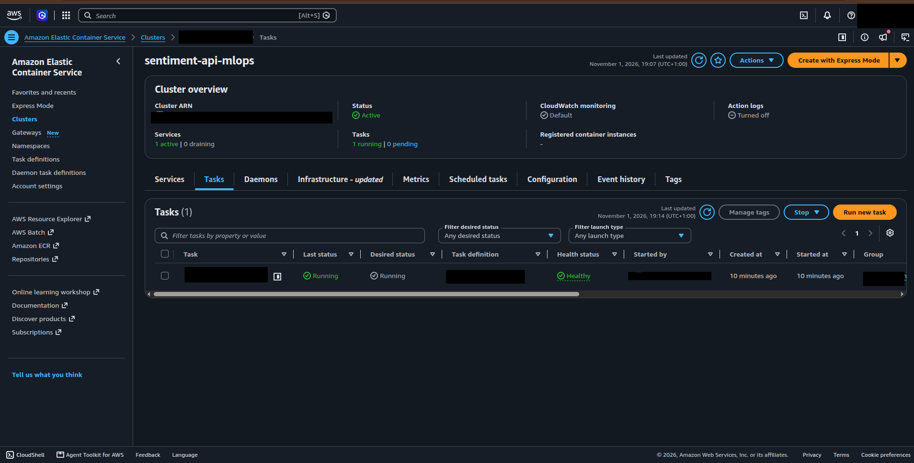
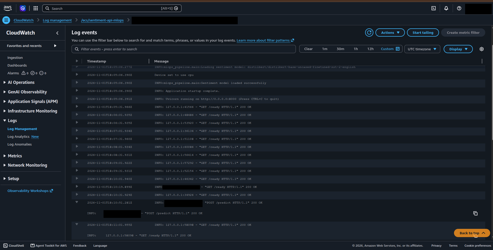

# Sentiment Analysis API — MLOps & CI/CD

A containerized sentiment analysis REST API built with **FastAPI**, **Hugging Face Transformers**, and **Docker**, with automated testing and image publishing through **GitHub Actions**, plus an **AWS ECS Fargate** deployment managed with **Terraform**.

## Project Overview

This project demonstrates an MLOps workflow for serving a pretrained machine learning model through a REST API. It includes API development, containerization, automated tests, a model quality gate, container publishing, and a manually operated AWS deployment.

The API uses a pretrained Transformer model to classify text sentiment as **positive** or **negative**.

## Architecture

```text
Client
  |
  v
FastAPI REST API
  |
  v
Hugging Face Sentiment Model
  |
  v
Prediction Response

GitHub Repository
  |
  v
GitHub Actions CI/CD
  |
  +--> Run Automated Tests
  |
  +--> Evaluate Real Model Quality
  |
  +--> Build Docker Image
  |
  +--> Push Image to Docker Hub

Manual AWS Deployment
  |
  +--> Build and Test Container Locally
  |
  +--> Push Image to Amazon ECR
  |
  +--> Terraform --> ECS Fargate (image pinned by digest)
                       |
                       +--> FastAPI + bundled sentiment model
                       |
                       +--> CloudWatch Logs

Client IP --> Security Group (TCP 8000) --> Fargate Task
```

## Tech Stack

- **Python** — Application development
- **FastAPI** — REST API framework
- **Hugging Face Transformers** — Pretrained sentiment analysis model
- **PyTorch** — Machine learning inference backend
- **Docker** — Application containerization
- **Pytest** — Automated testing
- **GitHub Actions** — CI/CD automation
- **Docker Hub** — Container image registry
- **AWS ECR / ECS Fargate** — Private image registry and container hosting
- **AWS VPC / IAM / CloudWatch** — Networking, execution permissions, and logs
- **Terraform** — Infrastructure provisioning and teardown

## Features

- REST API for sentiment analysis
- Pretrained Transformer model for text classification
- Health and readiness endpoints
- Input validation
- Automated tests with Pytest
- Dockerized application
- CI/CD pipeline using GitHub Actions
- Automated Docker image builds and publishing
- Versioned Docker images using Git commit SHA tags
- AWS deployment with a digest-pinned image and bundled model weights
- API access restricted to one client IPv4 address
- Container readiness checks and CloudWatch logging
- Repeatable infrastructure creation and cleanup with Terraform

## API Endpoints

| Method | Endpoint | Description |
|---|---|---|
| GET | `/health` | Health check |
| GET | `/ready` | Readiness check |
| POST | `/predict` | Predict text sentiment |
| GET | `/docs` | Interactive Swagger API documentation |

### Example Prediction Request

```bash
curl -X POST "http://localhost:8000/predict" \
  -H "Content-Type: application/json" \
  -d '{"text": "This project is amazing!"}'
```

### Example Response

```json
{
  "text": "This project is amazing!",
  "sentiment": "POSITIVE",
  "confidence": 0.999
}
```


## CI/CD Pipeline

GitHub Actions automates the testing and container publishing workflow.

The pipeline is designed to:

1. Check out the repository.
2. Set up Python and install dependencies.
3. Run automated tests and then the real-model quality gate.
4. Build the Docker image only after both gates pass.
5. Authenticate with Docker Hub using GitHub Actions secrets.
6. Push the image on pushes to `main`; pull requests run the gates without publishing.

AWS image publishing and deployment are currently manual. GitHub Actions does
not yet deploy to ECS or authenticate to AWS through OIDC.

### Docker Image Tags

The workflow publishes image tags such as:

- `latest` — The latest published image
- `<commit-sha>` — A version tied to a specific Git commit


## Running Tests

Install the locked dependencies and run the API tests:

```bash
uv sync --locked
uv run pytest -v
```

The tests replace the Hugging Face pipeline factory before application startup,
so they do not download or load model weights. They cover health and readiness,
positive and negative responses, input validation, unavailable models, and
inference failures. These tests verify API behavior; real-model quality evaluation
runs in a separate pipeline step.

To explicitly run with Hugging Face offline mode enabled:

```bash
HF_HUB_OFFLINE=1 TRANSFORMERS_OFFLINE=1 uv run pytest -v
```

## Model Quality Gate

Run real-model evaluation separately from the mocked API tests:

```bash
uv run python -m mlops_pipeline.evaluate
```

The first run downloads model weights. Evaluation and serving use the same pinned
model revision; `MODEL_ID` and `MODEL_REVISION` can override it together.
The evaluator writes `reports/evaluation.json` with accuracy, macro F1, per-class
metrics, a confusion matrix, predictions, and model/dataset identifiers.
It exits with status 1 if accuracy or macro F1 falls below 0.90.

GitHub Actions runs this gate on pull requests and pushes to `main`, uploads the
report even after a quality failure, and requires both tests and evaluation to
pass before publishing an image. Model downloads require access to Hugging Face.

The initial model scored 100% accuracy and macro F1 on the 24 curated examples.
This is a small synthetic regression check, not a real-world benchmark. See
[evaluation documentation](evaluation/README.md) for provenance, policy rationale,
and limitations. Automated deployment and comparison against the deployed model
remain future steps.

## AWS Deployment

The API was deployed and tested on **1 November 2026** in **Stockholm
(`eu-north-1`)**. Readiness and prediction requests succeeded against the public
task IP. All AWS resources created for the demo were subsequently removed to
avoid ongoing usage. There is no permanent live endpoint.

The deployment uses one Linux/x86 Fargate task with **1 vCPU and 2 GB RAM** in a
public subnet. A security group allows port 8000 only from the configured client
IPv4 address. The execution role can authenticate to ECR, pull the project image,
and write to its CloudWatch log group. Logs have three-day retention.

The Docker image downloads the pinned model during its build and serves from
that cache with Hugging Face offline mode enabled. ECS uses the pushed image's
SHA-256 digest rather than a mutable tag.

### Setup and deployment steps

Prerequisites: an AWS account with access to ECS, ECR, VPC, IAM, and CloudWatch;
AWS CLI v2 with `aws login` support; Docker; uv with Python 3.13; and Terraform meeting the version
constraints in `infra/versions.tf`.

1. Sign in with a named AWS CLI profile and select the project's region.
2. Configure your public IPv4 address and keep Terraform variables local.
3. Initialize Terraform and bootstrap the ECR repository.
4. Build the Linux/AMD64 image and test readiness and inference locally.
5. Authenticate Docker to ECR, push a unique image tag, and record its digest.
6. Review the full Terraform plan, then apply it to start one Fargate task.
7. Find the task's public IP, test `/ready` and `/predict`, and inspect its logs.
8. Capture the evidence, stop compute, delete stored images, and destroy the
   infrastructure.

See the [AWS deployment runbook](infra/README.md) for copyable commands covering
a fresh deployment, verification, and teardown. Examples use a generic profile
name and contain no personal account identifiers.

This is a short-lived portfolio deployment: it uses HTTP, one Availability Zone,
and a changing task IP. Deployments can interrupt availability.
### Deployment evidence

The screenshots below were captured before teardown. Identifying information has
been redacted.

**ECS task running and healthy**



**CloudWatch startup and request logs**

The logs show the model loading successfully, readiness checks, and a prediction
request returning HTTP 200. Successful requests demonstrate serving behavior;
they do not establish model accuracy. See the model quality gate and its dataset
limitations above.


